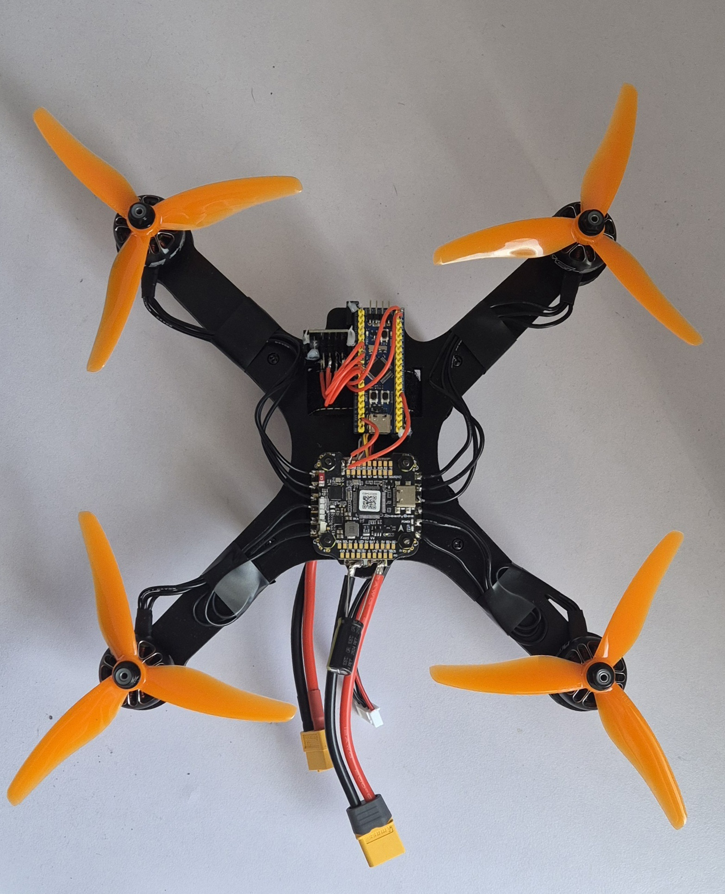
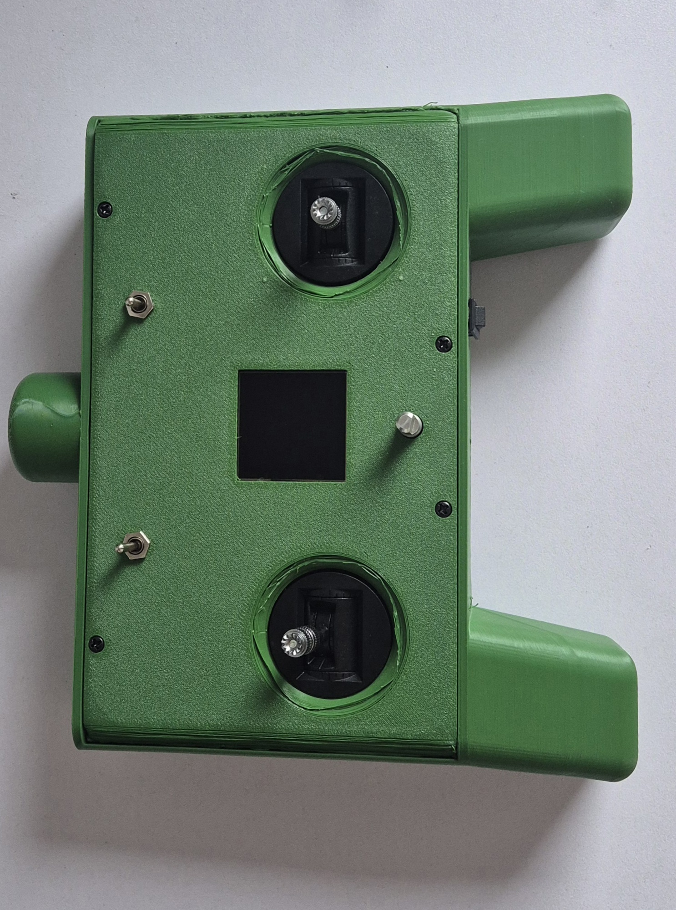
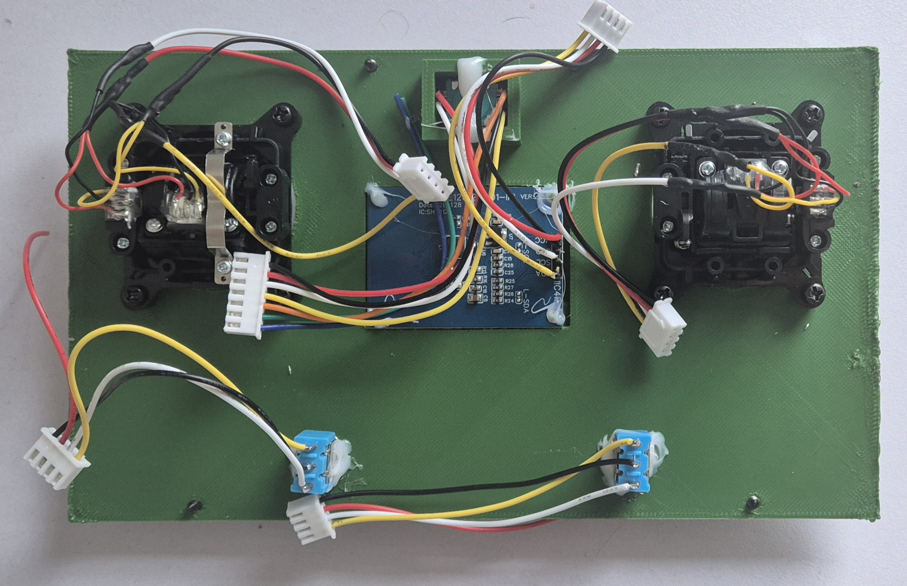
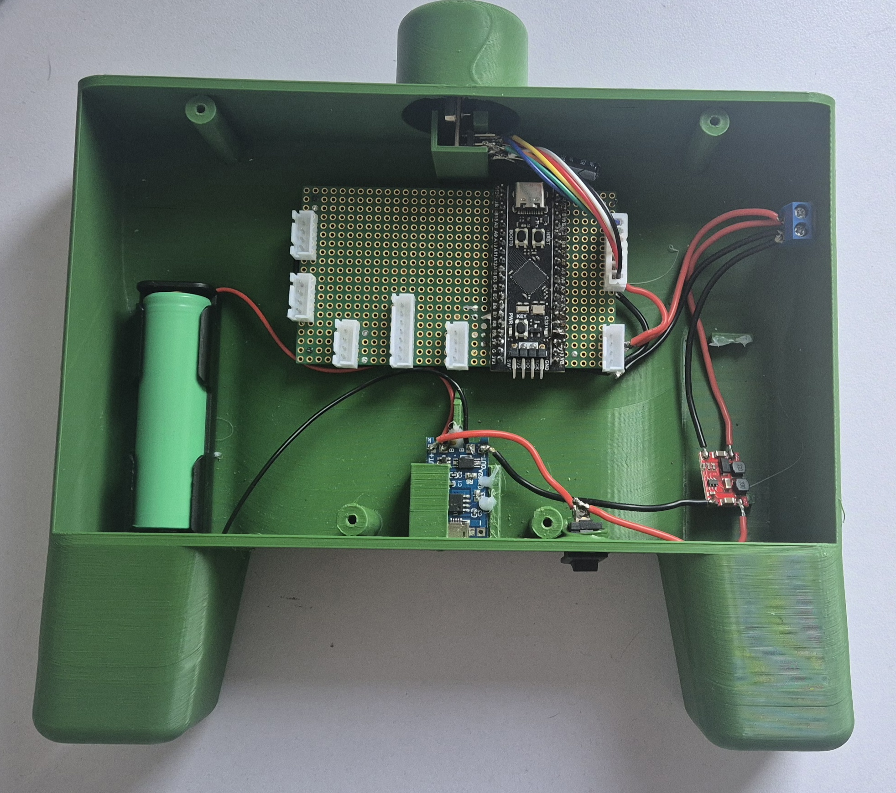

# DIY Drone with Custom RC Transmitter

A custom-built quadcopter with a 3D-printed frame, handheld RC transmitter and wireless receiver. STM32 microcontrollers handle the controls and radio communication, while a SpeedyBee F405 V4 flight controller running Betaflight handles flight stabilization and motor control.

This project combines mechanical design, electronics assembly, embedded C programming and system integration.

**Status:** Bench-tested. Flight testing is pending.

## Drone

The drone uses a custom 3D-printed frame and an STM32 receiver connected to the SpeedyBee flight controller. The receiver processes incoming radio packets and forwards accepted control values through SBUS.

## RC Transmitter

The handheld transmitter uses two gimbals for throttle, yaw, pitch and roll, plus an arm switch. An STM32 reads the controls, applies calibration and sends control packets through an nRF24L01 radio module.

The enclosure was designed in Fusion 360 and 3D printed.

### Internal Assembly

<table>
  <tr>
    <td width="50%" align="center">
      <b>Front panel</b> 
      Gimbals, switches and display wiring.
    </td>
    <td width="50%" align="center">
      <b>Base enclosure</b> 
      STM32 controller, radio module and power electronics.
    </td>
  </tr>
  <tr>
    <td valign="top">
      
    </td>
    <td valign="top">
      
    </td>
  </tr>
</table>

## How It Works

1. The transmitter reads the gimbals and arm switch.
2. Control values are calibrated and packed into radio packets.
3. The nRF24L01 link carries the packets to the drone receiver.
4. The receiver validates the data and sends SBUS frames to the flight controller.
5. Betaflight combines the commands with sensor readings to control the motors.

The STM32 receiver provides the radio-to-SBUS interface; flight stabilization runs on the SpeedyBee controller.

## Main Hardware

| Component | Purpose |
|---|---|
| STM32F411 Black Pill | RC transmitter controller |
| STM32F103C8T6 Blue Pill Plus | Drone receiver controller |
| Two nRF24L01 modules | Wireless communication |
| Two dual-axis gimbals and an arm switch | Pilot inputs |
| SpeedyBee F405 V4 | Flight controller running Betaflight |
| 55 A four-in-one ESC | Motor control |
| Four brushless motors and 5-inch propellers | Propulsion |
| 4S battery | Drone power |
| Custom 3D-printed frame and RC enclosure | Mechanical structure |
| 18650 Li-ion battery | RC transmitter power |
| TP4056 charging module | RC battery charging |
| DC–DC converter | Regulated 3.3 V supply for RC electronics |
| JST connectors and prototype board | Connections between RC components and mounting for the controller circuitry |

## Firmware

The repository contains two STM32 firmware projects:

- **Drone RC:** ADC acquisition using DMA, gimbal calibration, switch debouncing and radio packet transmission.
- **Drone:** Packet validation, sequence checking, arming protection and SBUS output.

Both projects use watchdogs. The receiver monitors the radio link and stops SBUS output when valid packets are no longer received, allowing Betaflight to detect receiver loss and apply its configured failsafe.

## Repository Structure

- **Drone RC/** — Handheld transmitter firmware.
- **Drone/** — Drone receiver firmware.
- **docs/images/** — Project photos and diagrams.

Within each firmware project:

- **Core/Src/** — Application source files, including `main.c`.
- **Core/Inc/** — Application header files.
- **Drivers/** — STM32 HAL and CMSIS libraries.
- **MDK-ARM/** — Keil project files and additional sources, including the nRF24 driver.
- **.ioc file** — STM32CubeMX peripheral and pin configuration.

To read the application code, start with `Core/Src/main.c`.

To build or flash the firmware, download the repository and open the `.uvprojx` file inside `MDK-ARM/` using Keil µVision.

## Development Tools

- Embedded C and STM32 HAL
- STM32CubeMX for peripheral configuration
- Keil µVision for building and debugging
- ST-Link for programming
- Betaflight and the SpeedyBee app for flight-controller configuration
- Fusion 360 for mechanical design

Gimbal calibration values and hardware connections are specific to this build and must be checked when adapting the firmware to another device.

## Mechanical Designs

Links to the CAD models and printable parts:

- **RC transmitter enclosure — GrabCAD:** https://grabcad.com/library/diy-rc-transmitter-enclosure-1
- **RC transmitter enclosure — Printables:** https://www.printables.com/model/1891624-diy-rc-transmitter-enclosure
- **Drone frame — GrabCAD:** https://grabcad.com/library/5-inch-drone-frame-with-removable-landing-legs-1
- **Drone frame — Printables:** https://www.printables.com/model/1895034-5-inch-drone-frame-with-removable-landing-legs

## Wiring

RC transmitter and drone wiring diagrams will be added here.

## Testing and Current Limitations

Bench testing has covered control reception in Betaflight, motor order and direction, arming and disarming, radio-loss behaviour, reconnection protection and watchdog resets.

Flight performance and outdoor radio range have not yet been validated. The current system does not provide autonomous navigation or position hold.

**Remove propellers before bench testing motors or changing control-system settings.**
